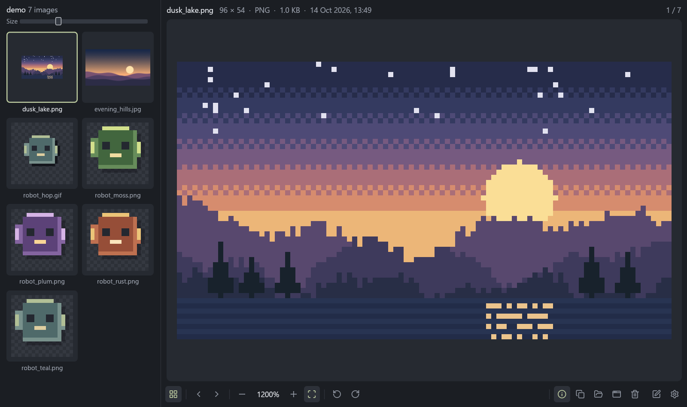
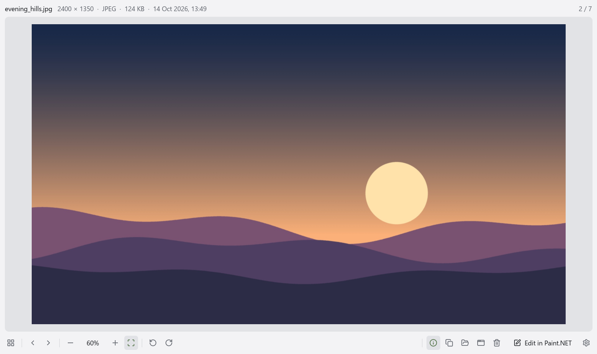

# Windows Image Viewer

A fast, minimal image viewer for Windows, built for pixel art and ordinary photos. It opens straight to the image, browses a folder instantly, and has none of the library, cloud or editing clutter of the built-in Photos app.





**[Download the latest release](https://github.com/GrowlDev/windows-image-viewer/releases/latest)**: a single `imageviewer.exe`, no installer needed.

## Features

- **Pixel-perfect zoom:** enlarging uses nearest-neighbour filtering at whole-number steps, aligned to *physical* screen pixels, so 100% is one image pixel per screen pixel even with Windows display scaling. Reduced photos use mipmapped smoothing so they don't shimmer. Zoom changes ease smoothly around the cursor.
- **Instant folder browsing:** use the arrow keys through the folder in Explorer's name order (frame2 before frame10). Neighbouring images decode in the background, and the current image stays on screen until the next one is ready, so browsing never flickers.
- **Gallery:** a side panel with every image in the folder as a card, at a size you choose. Thumbnails load in the background, only for cards on screen, so folders of thousands of images stay smooth.
- **Edit in your editor:** opens the image in the editor you choose. Paint.NET, Aseprite, Krita, GIMP, Photoshop, Affinity Photo, Pixelorama, Pyxel Edit and Paint are found automatically, and any other program can be picked. Save in the editor and the viewer updates within a second, keeping your zoom.
- **Animation:** GIF, APNG and animated WebP play automatically. You can pause, step frame by frame and turn looping off.
- **File info at a glance:** name, dimensions, format, size, date and position in the folder, plus the coordinates and colour of the pixel under the cursor.
- **The usual file actions:** rotate the view, copy to the clipboard, Show in Explorer, Open with…, and move to the Recycle Bin.
- **Formats:** PNG, APNG, JPEG (EXIF orientation honoured), GIF, BMP, WebP, ICO, TIFF, TGA, QOI.
- **Light and dark themes:** follows Windows by default, switching live when you change it, or set Dark or Light in Settings. The canvas stays neutral grey in both, so the theme never tints how an image's colours look.
- **Quick to start:** the image decodes while the window and GPU start up, and the window appears with the picture already drawn, with no blank or white frame.

No slideshow, printing, sharing, accounts or library.

## Keys and mouse

Press **F1** in the app for this list.

| Action | Keys / mouse |
|---|---|
| Next / previous image | → / ←, Page Down / Page Up, mouse forward/back buttons |
| First / last image | Home / End |
| Gallery | G |
| Zoom around the cursor | Mouse wheel (pinch on a touchpad) |
| Zoom in / out | + / − |
| Fit to window | 0, or the Fit button |
| 100% (actual pixels) | 1, or click the zoom percentage |
| Exact zoom 200–900% | 2–9 |
| Pan | Drag |
| Rotate right / left (view only, never saved) | Ctrl+. / Ctrl+, (or R / Shift+R) |
| Full screen | F11, Enter or double-click; Esc leaves |
| Play / pause animation | Space |
| Step animation frames | , and . |
| Loop on / off | L |
| Edit in your editor | E |
| Copy image | Ctrl+C |
| Move to Recycle Bin | Delete |
| Open a file | Ctrl+O, or drop one on the window |
| File info bar | I |
| Reload | F5 |
| Close | Esc |

## Install

1. Download `imageviewer.exe` from the [latest release](https://github.com/GrowlDev/windows-image-viewer/releases/latest) and put it somewhere permanent, for example `%LOCALAPPDATA%\Programs\Windows Image Viewer\`.
2. Run it, open **Settings** (the gear, bottom right) and click **Set up…** under *Default image viewer*.
3. Windows' **Default apps** page opens at the viewer. Choose it for the image types you want.

Setup registers the viewer for your Windows account only (no admin rights) and can be undone with **Remove** in the same place. Windows doesn't let apps make themselves the default, which is why you pick the types yourself. Windows Photos is never touched. If you move the exe later, run Setup again from the new copy.

Windows may show a SmartScreen warning the first time, because the exe isn't code-signed. Choose *More info → Run anyway*.

Building from source instead? `.\tools\install.ps1` builds, installs, registers and adds a Start menu entry; `.\tools\uninstall.ps1` removes it all.

## Build

Requires a recent stable Rust (edition 2024).

```powershell
cargo build --release    # target\release\imageviewer.exe
cargo test
```

## How it's put together

| File | Responsibility |
|---|---|
| `src/main.rs` | Command line, window options, startup decode |
| `src/app/mod.rs` | Window state, files and navigation, actions, the frame loop |
| `src/app/canvas.rs` | Image placement, checkerboard, rotation, pixel readout, empty state |
| `src/app/chrome.rs` | Info bar, toolbar, toasts, drop overlay, window title |
| `src/app/input.rs` | Keyboard, mouse buttons, wheel and pinch |
| `src/app/dialogs.rs` | Settings and the keyboard-shortcuts sheet |
| `src/app/playback.rs` | Animation timing and controls |
| `src/app/harness.rs` | Off-screen test harness |
| `src/view.rs` | Zoom/pan maths in physical pixels, easing |
| `src/loader.rs` | Background decode threads and the neighbour cache |
| `src/decode.rs` | File → frames, EXIF orientation, animation timing, thumbnails |
| `src/folder.rs` | Folder scan and Explorer sort order |
| `src/gallery.rs`, `src/thumbs.rs` | Side gallery and its background thumbnail cache |
| `src/editor.rs` | Image editor detection, choice and launching |
| `src/platform.rs` | Window cloaking and title bar colour, Explorer, Open with, Recycle Bin |
| `src/register.rs` | Default-apps registration under HKCU |
| `src/icons.rs`, `src/svg.rs` | Toolbar icons: [Lucide](https://lucide.dev) SVGs drawn by a small path renderer |
| `src/theme.rs` | Colours, widget style, Segoe UI plus per-script fallback fonts loaded on demand |
| `tools/make_icon.py` | Regenerates `assets/app.ico` and `assets/icon.png` from 16×16 pixel art |

Rendering is [egui](https://github.com/emilk/egui) on OpenGL. It's the egui backend with mipmaps, which keep reduced photos smooth.

The window stays DWM-cloaked (alive but invisible) until a frame containing the image has been presented. A saved maximized or fullscreen state is re-applied while it's still cloaked, because Windows would otherwise show the window before anything is drawn.

## Development harness

```bash
IMAGEVIEWER_BACKGROUND=1 imageviewer.exe <image> --size 1000x560 --do actual,zoomin,rotate --capture shot.png
```

- `IMAGEVIEWER_BACKGROUND=1` opens the window off-screen and unfocused. Test runs (background or `--capture`) use their own throwaway settings, reset each run.
- `--do` runs comma-separated actions once each image has loaded: `next`, `prev`, `zoomin`, `zoomout`, `actual`, `fit`, `zoomN`, `rotate`, `pause`, `step`, `info`, `gallery`, `settings`, `shortcuts`, `fullscreen`, `wait`.
- `--capture` saves a screenshot and exits.
- `IMAGEVIEWER_TRACE=<file>` logs startup phases and any frame whose UI work takes over 4 ms. Add `IMAGEVIEWER_TRACE_WINDOWS=1` to log every visibility, cloak and size change of the app's windows.

The GitHub Actions workflow checks formatting, clippy (warnings are errors) and tests, builds the release exe, and attaches it to a GitHub Release when a `v*` tag is pushed.
